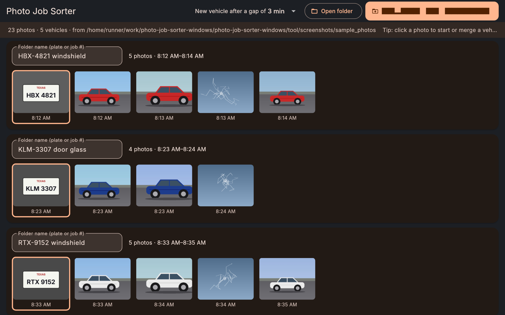

# Photo Job Sorter (Windows)

A Flutter desktop app for Windows that turns a day's dump of job photos into one tidy folder per vehicle or job.

Built for the kind of shop that takes hundreds of photos a week on one camera (auto glass, body shops, inspectors, contractors), where each vehicle's photos come in a row, often starting with a licence-plate close-up, and someone has to sort them by hand.

**Try it:** download `photo-job-sorter-windows.zip` from the [latest release](../../releases/latest), extract it, and run `photo_job_sorter.exe`. Nothing to install.

## Screenshots



Rendered by CI from the real app, using drawn sample photos (`tool/screenshots`).

## How it works

1. **Open folder:** pick the folder from the camera's memory card.
2. **Automatic grouping:** photos are sorted by time, and a new vehicle starts whenever there's a gap longer than the setting (1 to 30 minutes, 3 by default).
3. **Fix it with a click:** click any photo (say, a plate close-up) to start a new vehicle there. Click a group's first photo to merge it back into the previous one.
4. **Name each group:** type the plate or job number.
5. **Export:** each group is **copied** into its own folder (`TX ABC-1234\IMG_0041.jpg`, and so on).

## Safe by design

- **Originals are never moved or deleted.** Export only copies.
- **Nothing is overwritten.** Existing files are skipped and listed.
- **Two groups with the same name** become `Ford` and `Ford (2)`.
- **Same file name twice** in one group becomes `IMG_1.jpg` and `IMG_1 (2).jpg`.
- **Windows-safe folder names:** characters like `/ : ? "` are removed, and reserved names like `CON` are escaped.
- **Exporting into the source folder** is blocked.
- **Fast with big folders:** thumbnails are decoded at small size, so 500+ photos stay smooth.

## How it's built

```
lib/
  main.dart
  theme.dart
  logic/
    grouping.dart           Pure Dart: grouping, folder-name rules, export plan
    files.dart              Folder scan and the copy step (dart:io)
    sorter_controller.dart  Session state: splits, merges, names (ChangeNotifier)
  screens/
    home_screen.dart        Desktop UI: toolbar, groups, thumbnails, export dialogs
test/                       Unit tests: grouping, export plan, real file copies, controller
```

- **The logic is separate from the UI and tested,** including real file copies in a temp folder.
- **Export is planned before it runs,** so the confirmation dialog shows exactly what will happen.
- **CI** runs on a Windows machine: analyze, test, build the `.exe`, then zip it into Releases (`.github/workflows/build.yml`).

**Next step for a real shop:** detect the plate close-ups automatically (on-device OCR, or an AI vision API) and pre-fill the folder name. The grouping already supports manual starts, so automatic detection would plug into the same spot.

## Run it yourself (Windows)

Needs Flutter and Visual Studio with the "Desktop development with C++" workload.

```bash
flutter create --platforms=windows .
flutter pub get
flutter test
flutter run -d windows
```

---

Personal sample project by Abel Rios / Habex Studios. © 2026, all rights reserved. Shared so people can review my work; not licensed for reuse.
